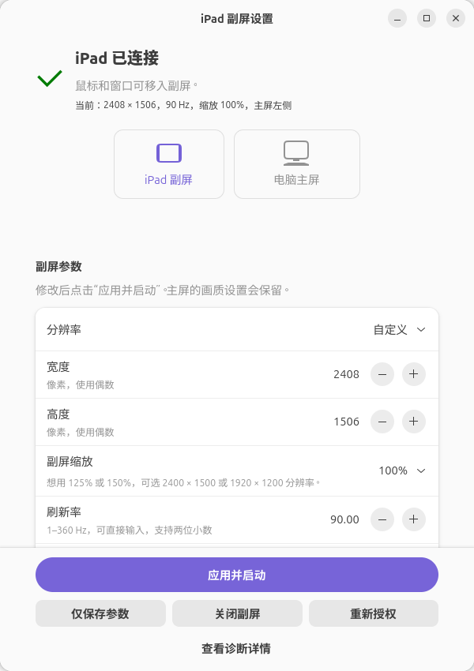

# Linux + Sunshine + Moonlight：把 iPad 作为扩展副屏

让 Linux 电脑继续显示主桌面，同时在 iPad 上打开另一个窗口。电脑端由本项目创建并摆放虚拟显示器，Sunshine 捕获并串流这块屏幕，iPad 的 Moonlight 接收画面。

本文基于本项目的实际使用流程编写。验证环境为 **Ubuntu 26.04、GNOME 50 / Wayland、原生 Sunshine v2026.914.233613、iPad Moonlight**；这不代表所有 Linux 桌面和 Sunshine 版本都已兼容。Sunshine 和 Moonlight 的通用安装、配对步骤以各自官方文档为准。

## 工作原理


虚拟屏幕、共享授权、串流连接是三个不同环节。看到虚拟屏幕不等于共享已成功，Sunshine 进程运行也不等于 Moonlight 可以连接。本工具会检查这些状态。

## 1. 确认适用环境

| 项目 | 本教程要求 |
| --- | --- |
| 电脑桌面 | 已登录的 GNOME 50 / Wayland 图形会话 |
| 虚拟屏幕 | Mutter 虚拟屏幕接口和 `gdctl` |
| Sunshine | 原生安装，支持 `portal` 捕获方式，使用默认配置目录和用户服务 |
| iPad | 已安装 Moonlight，初次配对与电脑处于同一局域网 |
| 网络 | 两台设备可以互相访问；访客网络的设备隔离可能阻止连接 |

在电脑终端查看会话类型和 GNOME 版本：

```bash
echo "$XDG_SESSION_TYPE"
gnome-shell --version
```

会话类型应为 `wayland`。本工具当前未适配 KDE、X11、Sunshine Flatpak 或无人登录的纯后台环境。其他 GNOME 版本也需要额外验证。

## 2. 安装 Sunshine，先完成配对

从 [Sunshine 官方安装说明](https://docs.lizardbyte.dev/projects/sunshine/latest/md_docs_2getting__started.html) 选择适合发行版、系统版本和 CPU 架构的原生软件包。本文使用其 Linux 用户服务；首次可这样启动：

```bash
systemctl --user start app-dev.lizardbyte.app.Sunshine.service
```

在**电脑本机**打开 [Sunshine 管理页面](https://localhost:47990)，完成管理员账户初始化。首次出现的证书提示通常来自 Sunshine 的自签名证书；先核对自己打开的是本机地址。服务启动方式和管理页面见 [Sunshine 官方说明](https://docs.lizardbyte.dev/projects/sunshine/latest/md_docs_2getting__started.html#initial-setup)。

在 iPad 上安装 [Moonlight](https://moonlight-stream.org/)，然后：

1. 让 iPad 和电脑连接同一局域网，允许 Moonlight 访问本地网络。
2. 打开 Moonlight，点选发现的电脑；若未发现，手动添加电脑的局域网 IP。电脑 IP 可在系统网络设置中查看。
3. Moonlight 显示配对 PIN 后，在电脑 Sunshine 管理页面的 **PIN** 页面输入它并提交。
4. 尝试打开 Sunshine 的桌面应用，确认基本串流可用，再结束这次串流。

配对方向是“把 Moonlight 显示的 PIN 输入 Sunshine”，完整过程见 [Moonlight 官方配对指南](https://github.com/moonlight-stream/moonlight-docs/wiki/Setup-Guide#using-sunshine)。这一步先确认连接通路；独立副屏在后面创建。

## 3. 安装副屏工具

以下依赖命令针对 Ubuntu；其他发行版需要自行对应软件包，并满足上面的 GNOME 环境要求：

```bash
sudo apt install git python3-gi python3-gi-cairo gir1.2-gtk-4.0 gir1.2-adw-1 \
  gir1.2-gstreamer-1.0 gstreamer1.0-pipewire libnotify-bin mutter-common-bin

git clone https://github.com/Fingxing2025/ipad-display-tool.git
cd ipad-display-tool
/usr/bin/python3 install.py --check
/usr/bin/python3 install.py --desktop
```

仅安装系统依赖需要 `sudo`，运行本工具和安装脚本使用当前桌面用户。`--check` 检查基础依赖，不代表显卡编码、系统共享授权和 iPad 串流都已验证。如果没有启用桌面目录，去掉 `--desktop`，仍会安装应用列表入口。

安装器需要 Sunshine 已初始化，且存在 `~/.config/sunshine/sunshine.conf` 和 `apps.json`。它会添加 Moonlight 可见的 **iPad 副屏** 应用，并保留已有应用。被替换文件的备份位于 `~/.local/state/ipad-display/install-backups/`。安装完成后不会立即启动副屏。

## 4. 第一次启动独立副屏

1. 在电脑应用列表搜索并打开 **iPad 副屏设置**。找不到入口时，在终端运行：

   ```bash
   /usr/bin/python3 ~/.local/libexec/ipad-display-settings.py
   ```

2. 首次先用 **1920 × 1080、60 Hz、100% 缩放**，位置按 iPad 的实际摆放选择，例如 **左侧**。
3. 点击 **应用并启动**，等待电脑上的屏幕共享窗口。
4. 选择 **Virtual remote monitor / 虚拟远程显示器**，点击 **共享**。选到笔记本主屏会让 iPad 显示主屏内容。
5. 等工具显示 **副屏已就绪**，在 iPad 的 Moonlight 中重新进入电脑应用列表，打开 **iPad 副屏**。
6. 在电脑上把一个普通窗口从主屏左边缘拖出去；如果副屏设在右侧，则从右边缘拖出。iPad 能看到该窗口，就说明扩展副屏已工作。



系统共享窗口可能被其他窗口挡住，可在电脑上按 `Alt+Tab` 查找。工具会触发授权提示，但 GNOME 的共享确认仍由用户完成。保持同一块虚拟屏幕和共享会话时会尝试复用授权；重建屏幕后通常需要重新选择。

**启动会重启 Sunshine 和桌面共享组件，当前 Sunshine 串流及其他应用正在进行的屏幕共享可能中断。** 这是当前版本为适应 GNOME 50 输出变化而采用的处理顺序，建议在没有其他共享任务时操作。

## 5. 调整分辨率、刷新率、缩放和位置

| 想调整什么 | 电脑工具中怎么设置 | 连接后检查什么 |
| --- | --- | --- |
| 画面精细度与宽高比 | 选择分辨率预设，或输入偶数宽高 | Moonlight 分辨率尽量与副屏一致；可选项取决于客户端版本 |
| 流畅度 | 刷新率可输入 1–360 Hz，支持两位小数 | Moonlight 也选择目标帧率；实际受 iPad 屏幕、解码、编码及网络能力限制 |
| 文字、窗口大小 | 调整“副屏缩放”，比例越大内容越大 | 使用工具列出的可用比例，不用降低分辨率来代替缩放 |
| 鼠标移动方向 | 位置选择左、右、上、下 | 从主屏对应边缘移入副屏 |

例如，工具支持输入 `59.94 Hz`，但这不表示每个 Moonlight 客户端都有 59.94 FPS 选项。应以客户端实际提供的设置和串流统计为准。

缩放可用比例取决于分辨率：按当前 GNOME 50 规则，`2408 × 1506` 可用 100% 和 200%；接近的 `2400 × 1500` 可用 125%、150% 等比例。若文字太小，可以选择后一种分辨率，再提高缩放。

修改后点击 **应用并启动**，重新完成需要的共享授权，再在 Moonlight 中连接。**仅保存参数**留待下次启动时应用。电脑主屏的分辨率、刷新率和缩放会由工具保留。

## 6. 日常开启和关闭

- **开启：**打开“iPad 副屏设置”并点击“应用并启动”，或直接运行“启动 iPad 副屏”。必要时确认共享，等待就绪后从 iPad 连接。
- **重复开启：**参数一致且会话正常时，工具会尝试继续使用现有副屏。
- **结束使用：**先结束 iPad 的串流，再点击电脑工具的 **关闭副屏**，或应用列表里的“关闭 iPad 副屏”。这会停止 Sunshine 并移除虚拟屏幕。
- **只关闭设置窗口：**副屏和串流会继续运行。只退出 Moonlight 也不会自动移除电脑上的虚拟屏幕。

启动入口需要电脑已经登录 GNOME 桌面。本教程不配置无人值守授权或开机自动连接。

## 7. 常见问题

| 现象 | 排查顺序 |
| --- | --- |
| Moonlight 显示电脑离线 | 先看电脑工具是否等待共享授权；完成授权并等到“副屏已就绪”。然后检查两台设备网络、Moonlight 本地网络权限、电脑 IP 和防火墙规则 |
| 点了共享，仍显示离线 | 查看工具是否仍在启动、报告共享错误或共享了其他屏幕；必要时点“重新授权”，重新选虚拟屏幕。若工具已就绪，再检查网络与 Sunshine 的地址绑定 |
| iPad 只看到主屏 | 点“重新授权”，共享窗口选择 Virtual remote monitor；再重新打开串流 |
| 鼠标移不到 iPad | 确认位置设置和实际摆放一致，并点击“应用并启动”；从相应屏幕边缘移动 |
| 修改参数后黑屏或断开 | 等待副屏重建，完成新授权，然后重新连接。先退回 1920 × 1080、60 Hz、100% 判断是否为高负载或参数问题 |
| 没有高刷新率或目标缩放 | 电脑允许的参数不等于 iPad 支持的参数；分别检查客户端帧率选项、iPad 屏幕能力和工具列出的缩放比例 |
| 找不到 Sunshine 用户服务 | 确认安装的是原生包，已完成初始化，并以同一桌面用户运行；本工具未适配 Flatpak |
| 安装检查通过但无法共享 | `--check` 不验证捕获后端。确认 Sunshine 版本支持 `portal`、GNOME 会话可用，并查看下面的日志 |

工具创建或重建副屏时会把 Sunshine 配置设为 `capture = portal`，使用 `~/.config/sunshine/` 和 `app-dev.lizardbyte.app.Sunshine.service`。自定义配置目录、端口、应用列表文件或其他启动方式不在当前验证范围；尤其工具的就绪检查使用默认 `47989` 端口。

若怀疑地址绑定，可在 Sunshine 管理页面的配置中搜索 `bind_address`，或只读查看 `~/.config/sunshine/sunshine.conf` 中这一项。绑定为 `127.0.0.1` 时 iPad 无法访问；绑定到指定网卡地址时，Moonlight 添加的 IP 应与之对应。默认未设置时监听所有可用接口，具体含义见 [Sunshine 官方网络配置](https://docs.lizardbyte.dev/projects/sunshine/latest/md_docs_2configuration.html#bind_address)。修改绑定也可能影响本工具通过 `127.0.0.1` 检查就绪状态。

## 8. 查看诊断信息

优先打开工具的诊断区域。也可以在终端只读查看状态和日志：

```bash
/usr/bin/python3 ~/.local/libexec/ipad-display-control.py status

systemctl --user status ipad-virtual-display.service \
  app-dev.lizardbyte.app.Sunshine.service --no-pager

journalctl --user -b -u ipad-virtual-display.service \
  -u app-dev.lizardbyte.app.Sunshine.service -n 100 --no-pager

tail -n 80 ~/.local/state/ipad-display/control.log
```

求助时请附上发行版、GNOME 和 Sunshine 版本、工具状态、错误文字，以及问题发生在配对、授权还是串流阶段。公开日志前删除配对信息、令牌和个人网络地址；不要上传整个 Sunshine 配置目录。

## 相关资料

- [本项目首页与安装说明](../README.md)
- [Sunshine 官方安装与服务说明](https://docs.lizardbyte.dev/projects/sunshine/latest/md_docs_2getting__started.html)
- [Sunshine 配置目录及参数](https://docs.lizardbyte.dev/projects/sunshine/latest/md_docs_2configuration.html)
- [Moonlight 官方设置、配对与网络排查](https://github.com/moonlight-stream/moonlight-docs/wiki/Setup-Guide)
- [Moonlight iOS 项目](https://github.com/moonlight-stream/moonlight-ios)

本项目是独立的副屏辅助工具；Sunshine 和 Moonlight 由各自项目维护。
